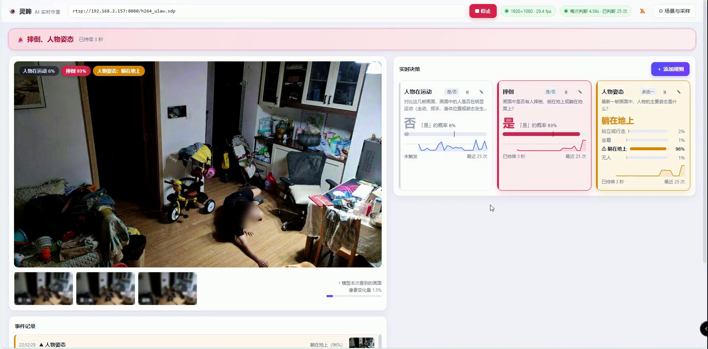
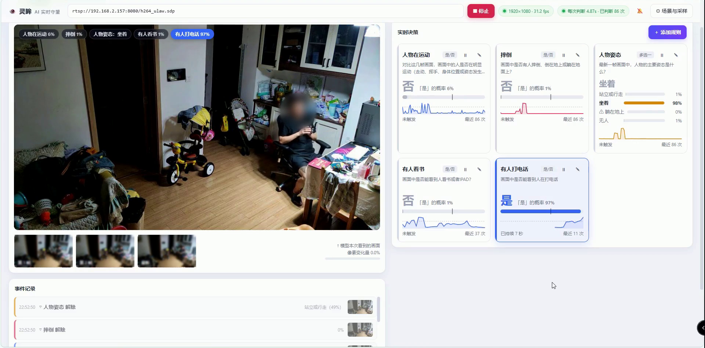
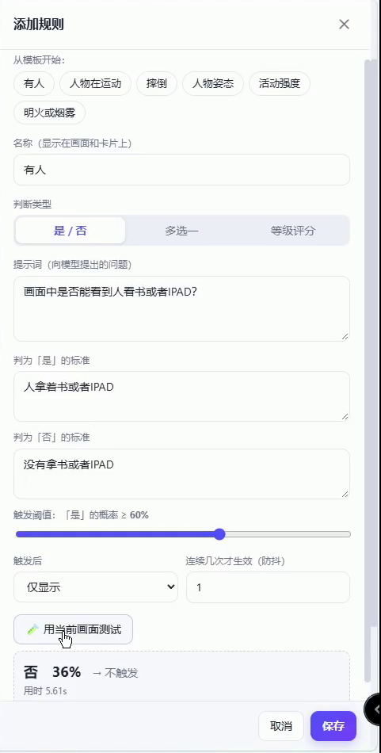
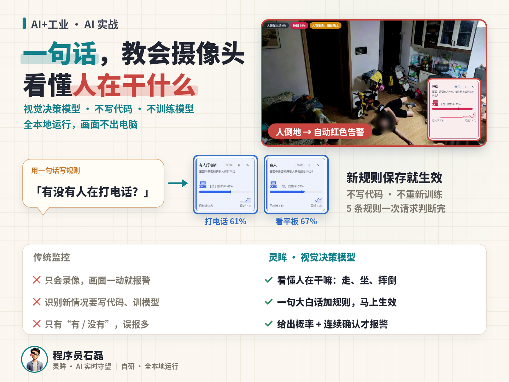

# 灵眸 · AI 实时守望

**用一句话教会摄像头看懂画面。** 灵眸是一套完全本地运行的实时视频监控系统：接入摄像头视频流，把最近几帧画面连同你用大白话写的规则一起交给本地视觉决策模型，模型直接给出判断和概率，再经过阈值与防抖触发告警。新增一种监控场景只需要写一句话，不用写代码，也不用重新训练模型。

> 参赛信息：第四届开放原子大赛 · 2026 开源行业解决方案创新赛，赛道一（开源基础软件与解决方案）。


> 完整演示视频（2 分 31 秒）：[B 站观看](https://www.bilibili.com/video/BV1NEpX6nEdH/)　｜　画面中的人脸均已模糊处理。


## 它解决什么问题

传统监控只会录像，最多做“画面有变化就报警”，误报多；想识别一种新情况（比如有人摔倒、有人打电话），往往要写专门的检测代码、收集数据、训练模型。灵眸换了一种做法：

| | 传统监控 / 定制算法 | 灵眸 |
|---|---|---|
| 能理解什么 | 画面有没有变化，或只能识别事先训练过的目标 | 看懂人在做什么：走、坐、躺、摔倒、看书、打电话…… |
| 新增一种场景 | 写检测代码、采集数据、训练模型 | 写一句大白话问题，保存即生效 |
| 判断结果 | 有 / 没有 | 概率（是/否）、各选项概率（多选一）、等级分数（评分） |
| 误报控制 | 阈值很粗糙 | 概率阈值 + 连续 N 次命中才触发（防抖） |
| 数据去向 | 常需上传云端 | 全部在本机运行，画面不出电脑 |

## 功能

- **多帧输入**：每次从最近 2 秒里均匀取 3 帧（均可配置），按时间顺序一起交给模型，所以“人有没有在动”这类需要时间信息的问题也能回答。
- **自然语言规则**：每条规则是一个问题加判断标准，三种题型：
  - `noul`（是 / 否）：返回“是”的概率；
  - `choice`（多选一）：返回各选项的概率，可指定哪些选项要告警；
  - `score`（等级评分）：返回等级分数。
- **概率 + 防抖**：每条规则可设置触发阈值和防抖次数 `hold`（连续 N 次命中才触发，连续 N 次未命中才解除）。
- **告警级别**：`none` 仅显示、`info` 记录变化、`warn` 黄色告警、`danger` 红色告警（界面上可开启提示音）。
- **事件记录与截图**：每次触发和解除都会写入事件列表，附当时的截图（最多保留 60 条）。
- **保存前先测试**：`/api/test` 可以用当前画面试跑一条尚未保存的规则，方便调提示词。
- **一次请求答多条规则**：所有启用的规则放进同一个请求，由模型一次回答。
- **多种视频源**：RTSP 视频流、本地视频文件（循环播放）、本机摄像头编号。
- **断线自动重连**：视频流中断后自动重试；模型暂时不可用时界面显示错误并持续重试。

## 界面截图

人倒地后，“摔倒”规则判“是”（93%），“人物姿态”规则判“躺在地上”，页面顶部亮起红色告警：



五条规则在同一次请求里一起作答：



保存前先用当前画面测试一条新规则：



一图看懂：



## 工作原理

```
摄像头 / RTSP / 视频文件
        │  OpenCV(FFmpeg)，TCP 低延迟拉流
        ▼
  帧缓冲（5 fps，保留 15 秒）──►  MJPEG 预览（约 12 fps）──┐
        │ 每轮取最近 window 秒内均匀的 N 帧                  │
        ▼                                                    ▼
  缩放到 max_side（默认 448）                         Web 界面（浏览器）
        │  一次 HTTP 请求：图片 + 场景描述 + 所有规则          ▲
        ▼                                                    │
  Ollama  POST /v1/systemone  （模型 clef-flash）            │
        │  返回每条规则的概率 / 选项概率 / 分数                │
        ▼                                                    │
  阈值判断 → 防抖（连续 hold 次）→ 告警级别 → 事件记录 + 截图 ─┘
```

后端是一个 FastAPI 单文件应用（`app.py`），前端是一个不依赖任何外部资源的单页 `static/index.html`。

## 快速开始

### 1. 准备环境

- Python 3.10 或更高版本
- [Ollama](https://ollama.com)，并拉取模型：

```bash
ollama pull clef-flash
```

模型主页：<https://ollama.com/library/clef-flash>。灵眸通过 Ollama 的 `/v1/systemone` 接口调用它，默认地址 `http://localhost:11434`。

### 2. 安装并启动

macOS / Linux：

```bash
git clone https://gitee.com/zhangleijay/monitor-agent.git lingmou
cd lingmou
./run.sh          # 首次运行自动创建虚拟环境、安装依赖、复制示例配置
```

或手动：

```bash
python3 -m venv .venv
.venv/bin/pip install -r requirements.txt
cp config.example.json config.json
.venv/bin/python app.py
```

Windows（PowerShell）：

```powershell
python -m venv .venv
.venv\Scripts\pip install -r requirements.txt
copy config.example.json config.json
.venv\Scripts\python app.py
```

启动后打开 <http://127.0.0.1:8765>。

### 3. 接入视频并添加规则

1. 在页面顶部填写视频源（见下表），点击开始。
2. 点击“添加规则”，选模板或自己写：选择题型，用大白话写一个问题，再写清楚什么算“是”、什么算“否”。
3. 点“用当前画面测试”，立刻看到这条规则在当前画面上的结果，满意后保存，规则马上生效。
4. 给规则设置触发阈值、防抖次数和告警级别。

| 视频源写法 | 说明 |
|---|---|
| `rtsp://用户名:密码@192.168.1.10:554/stream` | RTSP 视频流（IP 摄像头、手机“IP 摄像头”类应用等） |
| `/path/to/video.mp4` | 本地视频文件，播放完自动循环，适合没有摄像头时体验 |
| `0` | 本机摄像头编号 |

规则写法示例：

- 是 / 否：“画面中是否有人摔倒、倒在地上或躺在地面上？” 判“是”：有人正在摔倒，或已经倒在地面上；判“否”：画面中没有人，或所有人都在正常站立、行走、坐着。
- 多选一：“最新一帧画面中，人物的主要姿态是什么？” 选项：站立或行走 / 坐着 / 躺在地上（告警）/ 无人。

## 配置

配置保存在 `config.json`（首次运行从 `config.example.json` 复制，界面上的修改会自动写回）。

| 字段 | 默认值 | 说明 |
|---|---|---|
| `source` | 空 | 视频源 |
| `ollama_host` | `http://localhost:11434` | Ollama 地址 |
| `model` | `clef-flash` | 模型名称 |
| `scene` | “这是一个固定安装的监控摄像头拍摄的画面。” | 场景描述，随每次请求发给模型 |
| `frames` | 3 | 每次送入模型的帧数（1–6） |
| `window` | 2.0 | 取帧覆盖的最近秒数（0.2–10） |
| `interval` | 0 | 两次判断之间的最小间隔（秒），0 表示上一次完成后立即开始下一次 |
| `max_side` | 448 | 送入模型的图片最长边（像素，160–1280） |
| `rules` | 见示例 | 规则列表；字段含 `name`、`type`、`instructions`、`true_desc`、`false_desc`、`options`、`threshold`、`hold`、`severity` |

`config.json` 里可能含有你的摄像头地址和密码，已被 `.gitignore` 忽略，请不要提交。

## 模型接口约定

灵眸对模型的唯一依赖是 Ollama 的 `POST /v1/systemone`：

```jsonc
// 请求
{
  "model": "clef-flash",
  "state": "场景描述 + 说明这几张图片是按时间顺序拍摄的连续画面",
  "questions": {
    "<规则id>": {"type": "noul",   "instructions": "…", "criteria": {"true": "…", "false": "…"}},
    "<规则id>": {"type": "choice", "instructions": "…", "criteria": {"选项A": "说明", "选项B": "说明"}},
    "<规则id>": {"type": "score",  "instructions": "…", "criteria": ["等级0说明", "等级1说明"]}
  },
  "images": ["<base64 JPEG>", "…"],
  "keep_alive": "30m"
}
// 响应
{"answers": {
  "<规则id>": {"type": "noul",   "noul": 0.93},
  "<规则id>": {"type": "choice", "choice": "坐着", "probabilities": {"坐着": 0.97, "…": 0.01}, "confidence": 0.97},
  "<规则id>": {"type": "score",  "score": 2.4, "probabilities": {"…": 0.0}, "legend": {"0": "…", "1": "…"}}
}}
```

## HTTP 接口

| 方法与路径 | 作用 |
|---|---|
| `GET /` | Web 界面 |
| `GET /api/config`、`PUT /api/config` | 读取 / 保存配置 |
| `GET /api/presets` | 规则模板 |
| `POST /api/start`、`POST /api/stop` | 开始 / 停止监控 |
| `GET /api/state` | 当前状态：摄像头、每条规则的结果与历史、事件列表 |
| `POST /api/test` | 用当前画面试跑一条未保存的规则 |
| `GET /api/frame/{i}` | 最近一次送入模型的第 i 帧 |
| `GET /api/snap/{id}` | 事件截图 |
| `GET /video.mjpg` | MJPEG 实时预览 |

## 目录结构

```
app.py                 后端：拉流、采样、调用模型、阈值与防抖、事件记录、HTTP 接口
static/index.html      前端单页（无外部依赖）
config.example.json    示例配置（含 5 条示例规则）
requirements.txt       Python 依赖
run.sh / run.bat       启动脚本
docs/                  README 用到的演示 GIF 和截图
LICENSE                Apache License 2.0
```

## 已知限制

- 每次判断约 5 秒（取决于显卡 / 内存和规则数量），适合“分钟级、秒级”响应的看护类场景，不适合毫秒级的实时控制。
- 判断质量取决于模型和你写的规则。建议先用“用当前画面测试”反复调提示词，再结合阈值和防抖降低误报。
- 目前是单路视频源，界面仅监听本机 `127.0.0.1`，没有账号体系；如需远程访问，请自行加反向代理和认证。
- 本项目是监控辅助工具，不能替代专业的安防或医疗报警设备。使用时请遵守当地关于摄像头和个人影像的法律法规，并取得被拍摄者的同意。

## 许可证

[Apache License 2.0](LICENSE)

Copyright © 2026 程序员石磊
